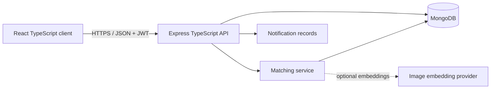

# CampusFind

CampusFind is a mobile-first lost-and-found system for university communities. A student reports a lost or found item, the matching service ranks opposite reports, the owner receives an alert, and an authorised reviewer verifies private ownership evidence before a safe handover.

The repository contains both parts of the MERN TypeScript application:

- `app/`, `components/`, `lib/`: Next.js and React TypeScript client, deployable as a responsive web app.
- `server/`: Node.js, Express and Mongoose TypeScript API for MongoDB.

When `NEXT_PUBLIC_API_BASE_URL` is absent, the client runs in a fully interactive demonstration mode. When the variable is set, users can sign in from Profile and new reports are written through the Express API.

## MVP capabilities

- Report lost and found items with category, date, landmark, description and image input.
- Browse and filter campus reports.
- Automatically generate ranked match suggestions after a report is created.
- Explain each match through image, text, attribute, location and date factors.
- Notify an owner when a possible match crosses the confidence threshold.
- Submit private ownership details and supporting evidence.
- Let an administrator approve, reject or request more evidence.
- Create a controlled handover record and require confirmation from both parties.
- Isolate data by university and enforce student, finder and administrator roles.

## Architecture



The deployed client and the Node API are deliberately separated. The client can be hosted on a static/edge platform, while the Express service runs on a Node host such as Render or Railway and connects to MongoDB Atlas.

## Vercel deployment

Deploy the repository root as a Next.js project. Vercel should use the default commands:

```text
Install command: npm install
Build command: npm run build
Output directory: leave blank (Next.js default)
Node.js version: 22.x
```

Set `NEXT_PUBLIC_API_BASE_URL` only after the Express API is deployed. Without it, the interface intentionally runs in interactive demonstration mode. The Express server is a separate MERN service and is not started by the frontend Vercel deployment.

## Matching model

For a lost report and a found report in the same university and category:

```text
M = 0.35I + 0.25T + 0.20A + 0.10L + 0.10D
```

- `I`: cosine similarity between optional image embeddings.
- `T`: similarity between normalized title and description tokens.
- `A`: agreement across category, colour, brand and model.
- `L`: landmark-token similarity or geographic distance when coordinates exist.
- `D`: closeness of the reported dates.

Candidates must occur within 30 days and score at least 60 by default. A missing image embedding receives a neutral score, so an image is helpful but never required. The algorithm suggests a match; it never approves ownership.

## Local setup

Requirements: Node.js 22+, npm and either Docker or an existing MongoDB instance.

```bash
npm install
cp .env.example .env
docker compose up -d
npm run server:seed
```

Start the API:

```bash
npm run server:dev
```

In a second terminal, expose the API URL to the client and start the interface:

```bash
NEXT_PUBLIC_API_BASE_URL=http://localhost:5000/api npm run dev
```

The seed command creates the University of Ibadan workspace and a local demonstration administrator. The seed output identifies the account; change its password before using a shared environment.

## Environment variables

| Variable | Purpose |
| --- | --- |
| `NEXT_PUBLIC_API_BASE_URL` | Browser-visible base URL ending in `/api`. |
| `MONGODB_URI` | MongoDB or MongoDB Atlas connection string. |
| `JWT_SECRET` | At least 32 random characters used to sign access tokens. |
| `CLIENT_ORIGIN` | Comma-separated client origins accepted by CORS. |
| `PORT` | Express port; defaults to `5000`. |
| `IMAGE_EMBEDDING_API_URL` | Optional external image-embedding service. |
| `IMAGE_EMBEDDING_API_KEY` | Optional embedding-service secret. |

Never commit a populated `.env` file. `.env.example` contains names and safe local defaults only.

## API surface

| Method | Route | Access | Purpose |
| --- | --- | --- | --- |
| `GET` | `/health` | Public | Service health check. |
| `GET` | `/api/auth/universities` | Public | Active university workspaces. |
| `POST` | `/api/auth/register` | Public | Create a student account. |
| `POST` | `/api/auth/login` | Public | Receive a seven-day JWT. |
| `GET` | `/api/reports` | Public | Filtered public report feed. |
| `POST` | `/api/reports` | Signed in | Create a report and run matching. |
| `GET` | `/api/matches/my` | Signed in | View the user's match suggestions. |
| `POST` | `/api/claims` | Lost-item owner | Submit private ownership evidence. |
| `GET` | `/api/notifications` | Signed in | View match and review alerts. |
| `GET` | `/api/admin/claims` | Administrator | Review the university claim queue. |
| `PATCH` | `/api/admin/claims/:id` | Administrator | Decide a claim and schedule handover. |
| `PATCH` | `/api/admin/handovers/:id/confirm` | Administrator | Log finder/owner confirmation. |

All write inputs are validated with Zod. Private report details, claim evidence and proof URLs are excluded from ordinary queries at the schema level.

## Verification

```bash
npm run build
npm run server:build
npm run server:test
```

The automated suite verifies the token, embedding and weighted-match calculations. API integration tests should be added with a disposable MongoDB test database before production use.

## Deliberate MVP limits

- Responsive web/PWA delivery comes before native Android or iOS binaries.
- Image recognition is provider-ready, but no paid model is hard-coded into the repository.
- Location is a selected campus landmark or optional point, not continuous GPS tracking.
- Ownership release always requires a person; there is no automatic approval.
- Live chat, blockchain, WhatsApp automation and cross-university discovery are postponed until the recovery workflow is proven.

This keeps the final-year project achievable while still demonstrating interface design, full-stack TypeScript, database modelling, authentication, ranked matching, privacy controls and an auditable administrative workflow.
