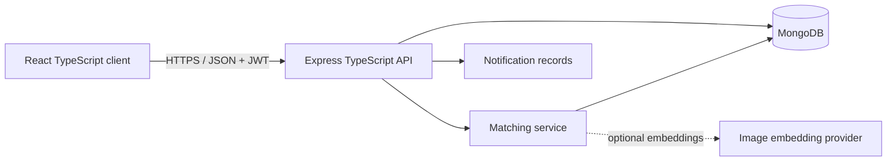

# CampusFind

CampusFind is a mobile-first lost-and-found system for university communities. A student reports a lost or found item, the matching service ranks opposite reports, the owner receives an alert, and an authorised reviewer verifies private ownership evidence before a safe handover.

The repository contains both parts of the MERN TypeScript application:

- `app/`, `components/`, `lib/`: Next.js and React TypeScript client, deployable as a responsive web app.
- `server/`: Node.js, Express and Mongoose TypeScript API for MongoDB.

When `NEXT_PUBLIC_API_BASE_URL` is absent, the client runs in a fully interactive demonstration mode. When the variable is set, users can sign in from Profile and new reports are written through the Express API.

## MVP capabilities

- Report lost and found items with category, date, landmark, description and image input.
- Browse and filter campus reports.
- Automatically generate ranked match suggestions after a report is created.
- Explain each match through image, text, attribute, location and date factors.
- Notify an owner when a possible match crosses the confidence threshold.
- Submit private ownership details and supporting evidence.
- Let an administrator approve, reject or request more evidence.
- Create a controlled handover record and require confirmation from both parties.
- Isolate data by university and enforce student, finder and administrator roles.

## Architecture



The deployed client and the Node API are deliberately separated. The client can be hosted on a static/edge platform, while the Express service runs on a Node host such as Render or Railway and connects to MongoDB Atlas.

## Vercel deployment

Deploy the repository root as a Next.js project. Vercel should use the default commands:

```text
Install command: npm install
Build command: npm run build
Output directory: leave blank (Next.js default)
Node.js version: 22.x
```

Set `NEXT_PUBLIC_API_BASE_URL` only after the Express API is deployed. Without it, the interface intentionally runs in interactive demonstration mode. The Express server is a separate MERN service and is not started by the frontend Vercel deployment.

## Matching model

For a lost report and a found report in the same university and category:

```text
M = 0.35I + 0.25T + 0.20A + 0.10L + 0.10D
```

- `I`: cosine similarity between optional image embeddings.
- `T`: similarity between normalized title and description tokens.
- `A`: agreement across category, colour, brand and model.
- `L`: landmark-token similarity or geographic distance when coordinates exist.
- `D`: closeness of the reported dates.

Candidates must occur within 30 days and score at least 60 by default. A missing image embedding receives a neutral score, so an image is helpful but never required. The algorithm suggests a match; it never approves ownership.

## Local setup

Requirements: Node.js 22+, npm and either Docker or an existing MongoDB instance.

```bash
npm install
cp .env.example .env
docker compose up -d
npm run server:seed
```

Start the API:

```bash
npm run server:dev
```

In a second terminal, expose the API URL to the client and start the interface:

```bash
NEXT_PUBLIC_API_BASE_URL=http://localhost:5000/api npm run dev
```

Before running the seed command, set `JWT_SECRET` to a private value of at least 32 characters and `SEED_ADMIN_PASSWORD` to a private value of at least 12 characters in your local `.env` file. The seed creates the University of Ibadan workspace and a generic local administrator; no reusable password is stored in the repository.

## Environment variables

| Variable | Purpose |
| --- | --- |
| `NEXT_PUBLIC_API_BASE_URL` | Browser-visible base URL ending in `/api`. |
| `MONGODB_URI` | MongoDB or MongoDB Atlas connection string. |
| `JWT_SECRET` | At least 32 random characters used to sign access tokens. |
| `SEED_ADMIN_PASSWORD` | Private local password used only while creating the demonstration administrator. |
| `CLIENT_ORIGIN` | Comma-separated client origins accepted by CORS. |
| `PORT` | Express port; defaults to `5000`. |
| `IMAGE_EMBEDDING_API_URL` | Optional external image-embedding service. |
| `IMAGE_EMBEDDING_API_KEY` | Optional embedding-service secret. |
| `S3_ENDPOINT` | Optional S3-compatible endpoint (AWS S3, Cloudflare R2, MinIO, etc.). |
| `S3_REGION` | Object-storage signing region; use the provider-required value (for Cloudflare R2, typically `auto`). |
| `S3_BUCKET` | Private object-storage bucket name. |
| `S3_ACCESS_KEY_ID` / `S3_SECRET_ACCESS_KEY` | Server-only storage credentials; never expose these to the browser. |
| `S3_SESSION_TOKEN` | Optional temporary credential session token. |
| `S3_FORCE_PATH_STYLE` | Use `true` for compatible path-style endpoints such as MinIO/R2; configure per provider. |

Never commit a populated `.env` file. `.env.example` contains names and safe local defaults only.

### Object storage setup

Object storage is optional for local development; text-only reports and claims continue to work without it. To enable uploads, configure the S3 endpoint, bucket, region and access credentials in the **API server environment**. The bucket should remain private. CampusFind uses five-minute signed PUT URLs for uploads and short-lived signed GET URLs for report photos. Claim evidence is stored under a separate `claim-evidence/` prefix and can only be downloaded through the authenticated, university-scoped administrator evidence endpoint.

Configure bucket CORS to allow `PUT` from the exact web-client origin(s) and allow the `Content-Type` request header. Do not put S3 credentials or a storage secret in `NEXT_PUBLIC_*` variables. The API verifies uploaded object ownership, content type and size before accepting an image or evidence key. Report photos allow JPEG, PNG and WEBP up to 8 MiB; claim evidence additionally allows PDF up to 5 MiB.

Example provider settings (replace placeholders; never commit real values):

- AWS S3: `S3_ENDPOINT=https://s3.us-east-1.amazonaws.com`, `S3_REGION=us-east-1`, `S3_FORCE_PATH_STYLE=false`.
- Cloudflare R2: `S3_ENDPOINT=https://<account-id>.r2.cloudflarestorage.com`, `S3_REGION=auto`, `S3_FORCE_PATH_STYLE=false`.
- MinIO: use the endpoint and region configured by your MinIO deployment, typically with `S3_FORCE_PATH_STYLE=true`.

Storage provider permissions must allow the configured access key to PUT, GET and HEAD objects in the configured bucket. Avoid public bucket policies; the application generates expiring URLs when authorized.

### MinIO live smoke test

The repository includes a local MinIO service and a live test that exercises the real API and object store. Run this against a **development/test database and bucket only**: the test creates a claim and leaves the test object and claim in place for inspection.

1. Create an untracked root `.env` file (it is ignored by Git) with locally generated values. Do not paste secrets into chat or commit them:

   ```dotenv
   MINIO_ROOT_USER=replace-with-a-local-only-username
   MINIO_ROOT_PASSWORD=replace-with-a-long-random-local-password
   S3_ENDPOINT=http://127.0.0.1:9000
   S3_REGION=us-east-1
   S3_BUCKET=campusfind-private
   S3_ACCESS_KEY_ID=use-the-local-MinIO-username
   S3_SECRET_ACCESS_KEY=use-the-local-MinIO-password
   S3_FORCE_PATH_STYLE=true
   ```

   For this isolated local smoke test only, the MinIO root credentials can be used by the API. For shared/staging environments, create a dedicated MinIO service account with only the required bucket permissions; do not use root credentials.

2. Start MinIO and create the private bucket:

   ```bash
   docker compose --env-file .env -f docker-compose.minio.yml up -d
   ```

   MinIO's API is bound to loopback at `http://127.0.0.1:9000`; its console is at `http://127.0.0.1:9001`. The compose initialiser creates the bucket and explicitly sets anonymous access to private.

3. Start CampusFind's API using the same root `.env`, with a disposable MongoDB and a valid `JWT_SECRET`. The API's `S3_ENDPOINT` must be reachable from the API process. For an API running in another container on the same Compose network, use `http://minio:9000` instead of `http://127.0.0.1:9000`; the browser-facing signed upload URL must also resolve from the machine running the test.

4. Prepare a fresh match owned by a test claimant, and a same-university administrator account. Log in using the normal API/UI, then export their JWTs and the match ID in your local shell. Do not put token values in source files or command history:

   ```bash
   export CAMPUSFIND_API_URL=http://127.0.0.1:5000/api
   read -rsp "Claimant JWT: " CAMPUSFIND_CLAIMANT_TOKEN; echo
   export CAMPUSFIND_CLAIMANT_TOKEN
   read -rsp "Administrator JWT: " CAMPUSFIND_ADMIN_TOKEN; echo
   export CAMPUSFIND_ADMIN_TOKEN
   read -rp "Fresh match ID owned by claimant: " CAMPUSFIND_MATCH_ID
   export CAMPUSFIND_MATCH_ID
   ```

5. Run the test:

   ```bash
   npm run storage:smoke-test
   ```

   The test requests a signed upload URL, uploads a small PDF directly to MinIO, creates a claim so the API checks object existence/content type/size using a signed HEAD request, verifies that anonymous requests receive HTTP 401 and a student cannot request the evidence link (HTTP 403), then downloads the same bytes using a same-university administrator's five-minute signed URL.

A successful result ends with `PASS`. If MinIO or the API is not configured, the test intentionally fails instead of reporting a false pass. The test creates a claim for the selected match, so use a disposable database and a fresh match per run.


## API surface

| Method | Route | Access | Purpose |
| --- | --- | --- | --- |
| `GET` | `/health` | Public | Service health check. |
| `GET` | `/api/auth/universities` | Public | Active university workspaces. |
| `POST` | `/api/auth/register` | Public | Create a student account. |
| `POST` | `/api/auth/login` | Public | Receive a seven-day JWT. |
| `GET` | `/api/reports` | Public | Filtered public report feed. |
| `POST` | `/api/uploads/presign` | Signed in | Create a short-lived upload URL for an allowed file type. |
| `POST` | `/api/reports` | Signed in | Create a report and run matching. |
| `GET` | `/api/matches/my` | Signed in | View the user's match suggestions. |
| `POST` | `/api/claims` | Lost-item owner | Submit private ownership evidence. |
| `GET` | `/api/notifications` | Signed in | View match and review alerts. |
| `GET` | `/api/admin/claims` | Administrator | Review the university claim queue. |
| `PATCH` | `/api/admin/claims/:id` | Administrator | Decide a claim and schedule handover. |
| `GET` | `/api/admin/claims/:claimId/evidence/:index` | Same-university administrator | Obtain a five-minute URL for private claim evidence. |
| `PATCH` | `/api/admin/handovers/:id/confirm` | Administrator | Log finder/owner confirmation. |

All write inputs are validated with Zod. Private report details, claim evidence and proof URLs are excluded from ordinary queries at the schema level.

## Verification

```bash
npm run build
npm run server:build
npm run server:test
```

The automated suite verifies the token, embedding and weighted-match calculations. API integration tests should be added with a disposable MongoDB test database before production use.

## Deliberate MVP limits

- Responsive web/PWA delivery comes before native Android or iOS binaries.
- Image recognition is provider-ready, but no paid model is hard-coded into the repository.
- Location is a selected campus landmark or optional point, not continuous GPS tracking.
- Ownership release always requires a person; there is no automatic approval.
- Live chat, blockchain, WhatsApp automation and cross-university discovery are postponed until the recovery workflow is proven.

This keeps the final-year project achievable while still demonstrating interface design, full-stack TypeScript, database modelling, authentication, ranked matching, privacy controls and an auditable administrative workflow.
