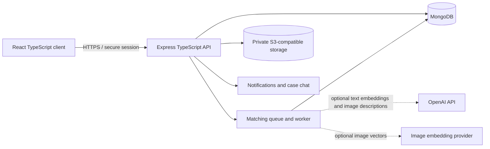

# CampusFind

CampusFind is a mobile-first lost-and-found system for university communities. A student reports a lost or found item, the matching service ranks opposite reports, the owner receives an alert, and an authorised reviewer verifies private ownership evidence before a safe handover.

The repository contains both parts of the MERN TypeScript application:

- `app/`, `components/`, `lib/`: Next.js and React TypeScript client, deployable as a responsive web app.
- `server/`: Node.js, Express and Mongoose TypeScript API for MongoDB.

When `NEXT_PUBLIC_API_BASE_URL` is absent, the client runs in a fully interactive demonstration mode. When the variable is set, users can sign in from Profile and new reports are written through the Express API.

## MVP capabilities

- Report lost and found items with category, date, landmark, description and image input.
- Browse and filter campus reports.
- Queue match work in the API background worker so report creation stays fast.
- Compare text with OpenAI embeddings when configured, and fall back to token similarity when it is not.
- Optionally analyze a report photo with OpenAI vision after the reporter opts in; visual descriptors help compare items even without a separate image-vector provider.
- Explain each match through visual, text, attribute, location and date factors.
- Notify both the lost-item owner and the finder when a possible match crosses the notification threshold.
- Submit private ownership details and supporting evidence.
- Give the owner and finder an in-app chat after a claim enters review; message alerts appear in the notification feed.
- Let an administrator approve, reject or request more evidence.
- Keep found-item verification details private from public reports and visible only to administrators.
- Create a controlled handover record, notify the owner and finder, and close the case only after both confirm the return.
- Verify campus email addresses, rotate short-lived access sessions, and support Google or Apple sign-in after linking those identities to a verified campus account.
- Store report photos and claim evidence in private S3-compatible object storage. Photos are normalized to remove embedded camera metadata, and reviewer evidence is served with short-lived signed links.
- Isolate data by university and enforce student, finder and administrator roles.

## Architecture



The deployed client and the Node API are deliberately separated. The client can be hosted on a static/edge platform, while the Express service runs on a Node host such as Render or Railway and connects to MongoDB Atlas and an S3-compatible object store. Keep the client and API on the same site where possible; cross-site cookie deployments need HTTPS and `AUTH_COOKIE_SAME_SITE=none`.

## Vercel deployment

Deploy the repository root as a Next.js project. Vercel should use the default commands:

```text
Install command: npm install
Build command: npm run build
Output directory: leave blank (Next.js default)
Node.js version: 22.x
```

Set `NEXT_PUBLIC_API_BASE_URL` only after the Express API is deployed. Without it, the interface intentionally runs in interactive demonstration mode. The Express server is a separate MERN service and is not started by the frontend Vercel deployment.

## Matching model

For opposite report types in the same university and within 90 days:

```text
M = 0.35I + 0.25T + 0.20A + 0.10L + 0.10D
```

- `I`: cosine similarity between compatible image vectors or same-model visual-description embeddings; otherwise neutral.
- `T`: cosine similarity between same-model OpenAI text embeddings, or token similarity when embeddings are unavailable.
- `A`: agreement across category, colour, brand and model.
- `L`: landmark-token similarity or geographic distance when coordinates exist.
- `D`: closeness of the reported dates.

Candidates are scored from 0 to 100. A score of 60 creates a suggestion and a score of 75 sends match notifications to both report owners. Missing image data receives a neutral image score, so a photo is helpful but never required. The algorithm suggests a match; it never approves ownership. OpenAI keys stay on the API server and the vision analysis is opt-in per report.

## Local setup

Requirements: Node.js 22+, npm and Docker (or MongoDB plus an S3-compatible object store).

```bash
npm install
cp .env.example .env
docker compose up -d
npm run server:seed
```

Start the API:

```bash
npm run server:dev
```

In a second terminal, expose the API URL to the client and start the interface:

```bash
NEXT_PUBLIC_API_BASE_URL=http://localhost:5000/api npm run dev
```

Before running the seed command, set `JWT_SECRET` to a private value of at least 32 characters and `SEED_ADMIN_PASSWORD` to a private value of at least 12 characters in your local `.env` file. Docker starts MongoDB and MinIO; the API creates the local object bucket on first use. The seed creates the University of Ibadan workspace and a generic local administrator; no reusable password is stored in the repository.

In development, verification codes are printed to the API console when SMTP is not configured. Configure SMTP before production use. Google and Apple credentials are optional; set their callback URL to `https://<api-host>/api/auth/oauth/google/callback` and `https://<api-host>/api/auth/oauth/apple/callback`. Users first verify a campus email account, then link a provider from Profile. The provider identity must be linked before it can be used to sign in.

## Environment variables

| Variable | Purpose |
| --- | --- |
| `NEXT_PUBLIC_API_BASE_URL` | Browser-visible base URL ending in `/api`. |
| `MONGODB_URI` | MongoDB or MongoDB Atlas connection string. |
| `JWT_SECRET` | At least 32 random characters used to sign access tokens. |
| `SEED_ADMIN_PASSWORD` | Private local password used only while creating the demonstration administrator. |
| `CLIENT_ORIGIN` | Comma-separated client origins accepted by CORS. |
| `PORT` | Express port; defaults to `5000`. |
| `API_PUBLIC_URL` | Public API origin used for report-photo URLs and OAuth callbacks. |
| `S3_ENDPOINT` / `S3_PUBLIC_ENDPOINT` | Private storage endpoint used by the API and signed URLs. |
| `S3_BUCKET`, `S3_ACCESS_KEY_ID`, `S3_SECRET_ACCESS_KEY` | Private media bucket and credentials. |
| `IMAGE_EMBEDDING_API_URL` / `IMAGE_EMBEDDING_API_KEY` | Optional image-vector provider; the API sends it a short-lived photo URL. |
| `OPENAI_API_KEY` | Optional server-only key for text embeddings and opt-in photo descriptions. |
| `OPENAI_EMBEDDING_MODEL` / `OPENAI_VISION_MODEL` | Optional model names for semantic and visual matching. |
| `SMTP_HOST`, `SMTP_PORT`, `SMTP_USER`, `SMTP_PASSWORD`, `EMAIL_FROM` | Email verification and password-reset delivery. |
| `GOOGLE_CLIENT_ID`, `GOOGLE_CLIENT_SECRET` | Google web sign-in credentials. |
| `APPLE_CLIENT_ID`, `APPLE_TEAM_ID`, `APPLE_KEY_ID`, `APPLE_PRIVATE_KEY` | Apple web sign-in credentials. |
| `AUTH_CALLBACK_URL` | OAuth callback base; defaults to `API_PUBLIC_URL/api/auth/oauth`. |
| `AUTH_COOKIE_SAME_SITE` | Cookie policy; use `none` only for separate HTTPS sites. |

Never commit a populated `.env` file. `.env.example` contains names and safe local defaults only.

## API surface

| Method | Route | Access | Purpose |
| --- | --- | --- | --- |
| `GET` | `/health` | Public | Service health check. |
| `GET` | `/api/auth/universities` | Public | Active university workspaces. |
| `POST` | `/api/auth/register` | Public | Begin registration using a University of Ibadan email. |
| `POST` | `/api/auth/verify-email` | Public | Verify an emailed code and create a session. |
| `POST` | `/api/auth/login` | Public | Sign in with email and password. |
| `POST` | `/api/auth/password-reset/request` | Public | Send a password reset code without revealing whether an account exists. |
| `POST` | `/api/auth/password-reset/confirm` | Public | Change a password and revoke existing sessions. |
| `POST` | `/api/auth/oauth/:provider/start` | Public | Begin Google or Apple sign-in. |
| `POST` | `/api/auth/oauth/:provider/link` | Signed in | Link a verified provider identity to a campus account. |
| `POST` | `/api/uploads` | Signed in | Normalize and privately store report photos or claim evidence. |
| `GET` | `/api/reports` | Public | Filtered public report feed. |
| `POST` | `/api/reports` | Signed in | Create a report and queue matching. |
| `GET` | `/api/matches/my` | Signed in | View the user's match suggestions. |
| `GET/POST` | `/api/chats/:matchId/messages` | Match participants after claim | Read or send private case messages. |
| `POST` | `/api/claims` | Lost-item owner | Submit private ownership evidence or resubmit after an evidence request. |
| `GET` | `/api/claims/my` | Signed in | Track claim decisions without exposing private evidence. |
| `GET` | `/api/notifications` | Signed in | View paginated match, claim, handover and chat alerts. |
| `PATCH` | `/api/notifications/:notificationId/read` | Signed in | Mark one notification as read. |
| `PATCH` | `/api/notifications/read-all` | Signed in | Mark all notifications as read. |
| `GET` | `/api/admin/audit` | Administrator | View university-scoped claim and handover audit events. |
| `GET` | `/api/admin/claims` | Administrator | Review open claims and private verification details for the university. |
| `PATCH` | `/api/admin/claims/:id` | Administrator | Decide a claim and schedule handover. |
| `GET` | `/api/handovers/my` | Owner or finder | View handovers linked to the user's reports. |
| `PATCH` | `/api/handovers/:id/confirm` | Handover participant | Confirm receipt or transfer; both parties must confirm to close the case. |

All write inputs are validated with Zod. Private report details, claim evidence and proof URLs are excluded from ordinary queries at the schema level.

## Verification

```bash
npm run build
npm run server:build
npm run server:test
```

The default automated suite verifies the token, embedding and weighted-match calculations. The opt-in API integration suite exercises authentication guards, university-scoped chat access, contact-detail blocking, claims, administrator review, notifications and two-party handover completion against a disposable MongoDB database.

Start the local services first:

```powershell
docker compose up -d mongo minio
```

Run the integration suite against a separate database. The test does not call OpenAI, SMTP, OAuth providers or object storage, so those services do not need production credentials:

```powershell
$env:NODE_ENV = "test"
$env:MONGODB_URI = "mongodb://127.0.0.1:27017/campusfind_integration"
$env:JWT_SECRET = "local-integration-secret-change-me-32-characters"
$env:RUN_API_INTEGRATION_TESTS = "1"
npm run server:test:integration
```

The test drops only the database named in `MONGODB_URI` and closes its temporary HTTP server when it finishes. Use a disposable database name and do not point it at a shared or production MongoDB instance.

For a complete local smoke test, run the API and web client in separate terminals after the integration suite:

```powershell
$env:CLIENT_ORIGIN = "http://localhost:3000"
npm run server:dev
```

```powershell
$env:NEXT_PUBLIC_API_BASE_URL = "http://localhost:5000/api"
npm run dev
```

Then verify registration, email verification, report-photo upload, matching, notifications, claim evidence, participant-only chat, administrator review, and two-party handover confirmation in the browser. OAuth callbacks require HTTPS-compatible public URLs and real provider credentials; the local email fallback prints verification codes in the API console.

## Deliberate MVP limits

- Responsive web/PWA delivery comes before native Android or iOS binaries.
- OpenAI embeddings and opt-in visual descriptions need an API key; true image-image vector matching still needs a compatible image embedding provider.
- Location is a selected campus landmark or optional point, not continuous GPS tracking.
- Ownership release always requires a person; there is no automatic approval.
- Chat is limited to the two report participants after a claim is submitted; it polls while the chat screen is open and blocks email addresses and phone numbers.
- Administrative claim decisions and handover confirmations are recorded in a university-scoped audit log.
- Notifications and audit records are paginated; clients should request only the page size they need.
- Native mobile apps, blockchain, WhatsApp automation and cross-university discovery are postponed until the recovery workflow is proven.

This keeps the final-year project achievable while still demonstrating interface design, full-stack TypeScript, database modelling, authentication, ranked matching, privacy controls and an auditable administrative workflow.
